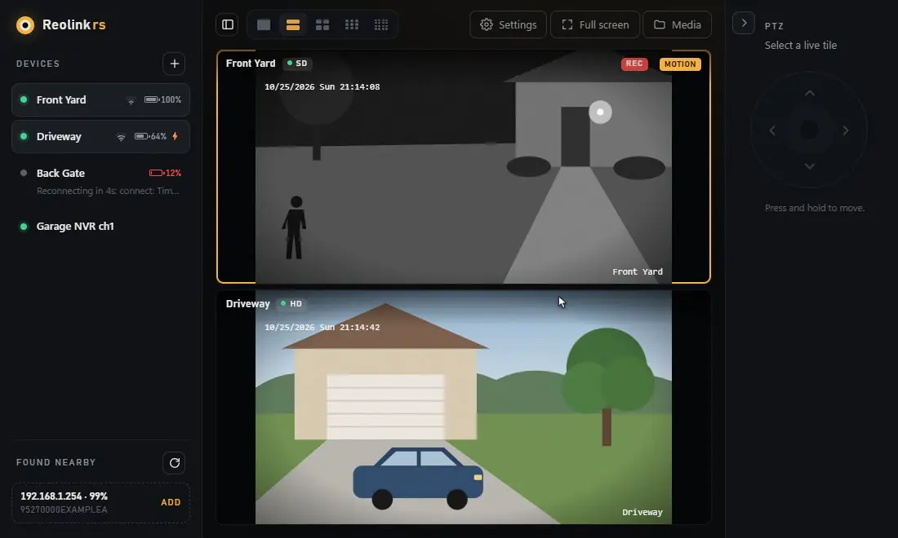
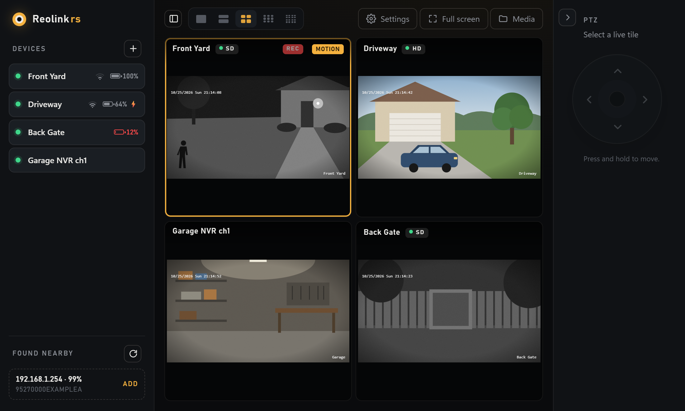
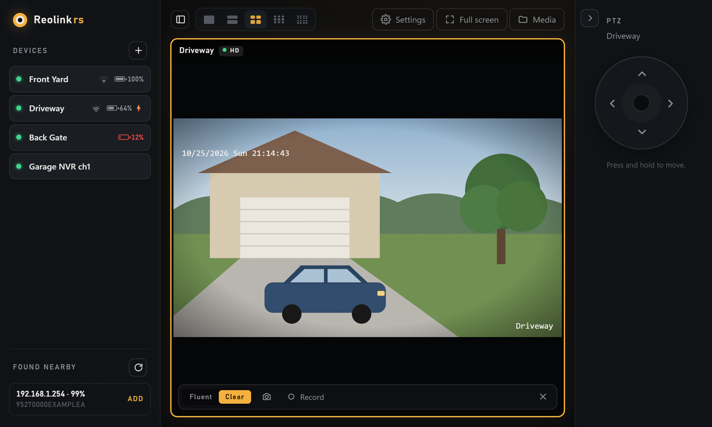
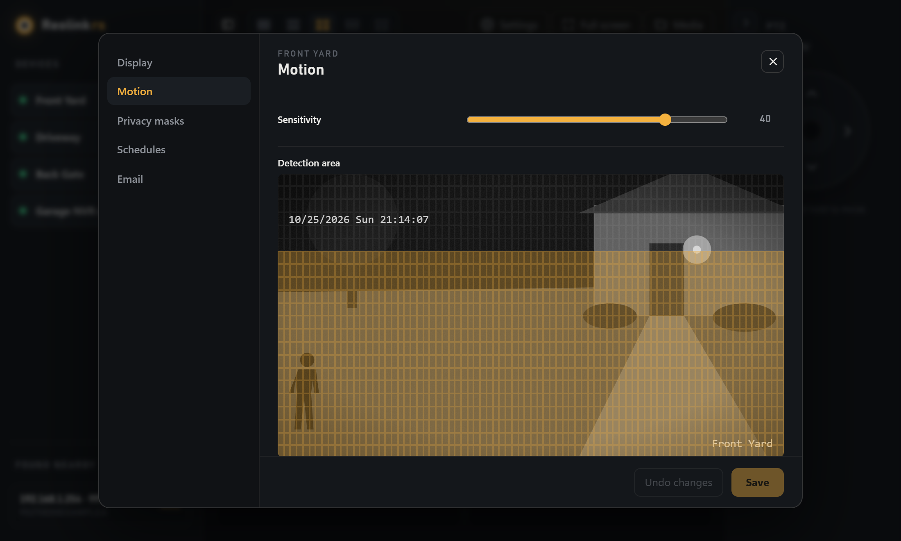
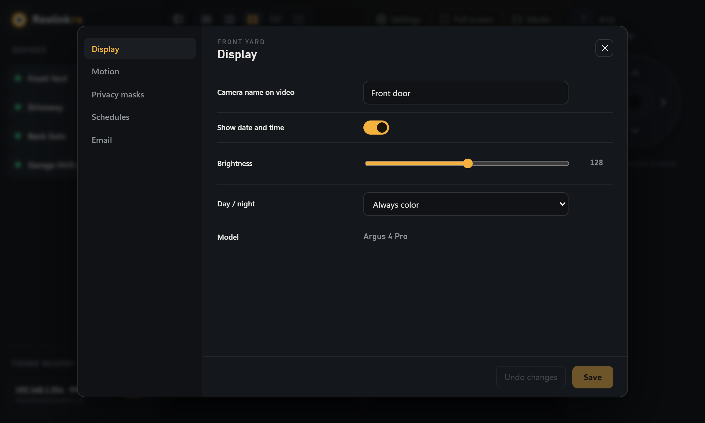

# Reolink-rs



Rust rewrite of the Reolink desktop client (reference: Reolink 8.21.31, Electron), built on
[`neolink_core`](https://github.com/QuantumEntangledAndy/neolink) for the Baichuan protocol and a Tauri 2 UI
(plain HTML/CSS/JS in `ui/`, no Node build). Video reaches the WebView from a token-protected 127.0.0.1 server
(`src/stream.rs`): the camera's own H.264/H.265, decoded in the page with WebCodecs, or MJPEG made by ffmpeg on
Linux and wherever the WebView can't decode the codec. Recordings are fragmented-MP4 stream copies of the main stream.

**Deliberate difference from the official client:** no battery/idle disconnect. Every device stays
connected (pinged every 5 s) and reconnects automatically, resuming its live view and recording.

`neolink_core/` is a vendored copy (upstream rev 6e05e78) with Windows fixes:
- UDP sockets disable `SIO_UDP_CONNRESET`; otherwise one ICMP "port unreachable" kills discovery with error 10054.
- Stream and connection task errors are surfaced/logged instead of a bare `StreamFinished`.
- Unparseable frames, stray extension payloads and bad UDP datagrams are skipped instead of dropping the connection.
- `get_xml`/`set_xml` raw settings access (read-modify-write keeps fields the typed model doesn't know).

| Live grid | Single view |
|---|---|
|  |  |
| **Motion zone over a live snapshot** | **Camera settings** |
|  |  |

Re-record the demo above (Playwright + ffmpeg, synthetic feeds): `node docs/demo/record.cjs`; retake the screenshots: `node docs/demo/screenshots.cjs`.

Test a saved camera end to end (stream, decode, ~8 s recording): `cargo run --example probe -- "<device name>" [main|sub]`.
Check that recording takes the main stream and a snapshot doesn't stall it: `cargo run --example record_stream_check -- "<device name>"`.
Serve one camera's stream for trying the WebCodecs player in a browser: `cargo run --example raw_check -- "<device name>" [main|sub] [secs]`.
Measure each saved camera's video/audio bitrate per stream: `cargo run --release --example bitrate`.
Validate camera settings (add `--write` for reversible write checks): `cargo run --release --example settings_check`.
Dump every readable settings message as XML (passwords redacted): `cargo run --release --example settings_dump -- <dir>`.

## Run

Requires `ffmpeg.exe` on PATH or next to the exe (used to write MP4s, and to decode where WebCodecs can't).

```bash
cargo run --release
```

Devices are saved to `%APPDATA%\Reolink-rs\devices.json` (`~/.config/Reolink-rs` on Linux, `~/Library/Application Support/Reolink-rs` on macOS). Snapshots and recordings go to `Videos\Reolink-rs` in your user folder.

## Status

Phase 1 (done): add/edit/remove devices (IP or UID, NVR channel), 1 / 2-stacked / 4 / 9 / 16 live layouts,
Clear/Fluent streams, double-click a tile for single view (Esc to exit), collapsible PTZ panel (hold to move),
snapshot, MP4 recording, battery level.

Phase 2 (done): camera settings, 14 pages, 119 fields per camera: device info, display, stream, detection &
recording, motion (read-only on Argus 4 Pro), privacy masks, schedules, email, FTP, network, smart detection &
time-lapse, lights, system, maintenance, with schedule/area/mask editors drawn over a live snapshot, email/FTP
tests, time sync and reboot. App settings: folders, recording segments, disk-space warning, GPU decoding,
network scan, run at startup. LAN auto-detect of cameras. Inventory, SDK command table and validation results:
[docs/settings-inventory.md](docs/settings-inventory.md).

Playback (done for local recordings): Playback in the left sidebar opens an NVR view of the recording
folder: day picker, one timeline row per camera (click to play, scroll to zoom, drag to pan), segments play back
to back across gaps, 0.25-16x speed, frame step, ±10 s, clip export (In/Out, no re-encode, into `Clips\`),
still frame to the snapshot folder, show in folder, delete, and a Thumbnails view of the day's recordings
(preview frames cached in `.thumbs\`). Live streams pause while it's open.
Keys: Space, ← →, , . (frame), [ ] (speed), I / O, F.

Tray (0.4.1): minimizing or closing hides the window to the tray (left-click to show it again). The tray's
right-click menu has Show, Pause recording (stops manual and scheduled recording until unchecked) and Quit.

Reboot a saved camera and time its reconnect: `cargo run --example reboot_check -- "<device name>"`.

Next phases toward parity with the official client:
1. Live audio and two-way talk; PTZ presets/zoom/focus
2. Playback of SD card / NVR recordings (search and download over Baichuan); motion markers on the timeline
3. Alarm/motion notifications and event log; firmware update
4. Users, Wi-Fi network switching, AI detection config (need protocol work; read-only today)

## Patching the official client instead

`patch/patch_battery_timeout.py` removes the same disconnect from the installed Electron app.
Run it from an elevated shell; re-run after every Reolink update.

## License

AGPL-3.0-or-later (inherited from `neolink_core`).
