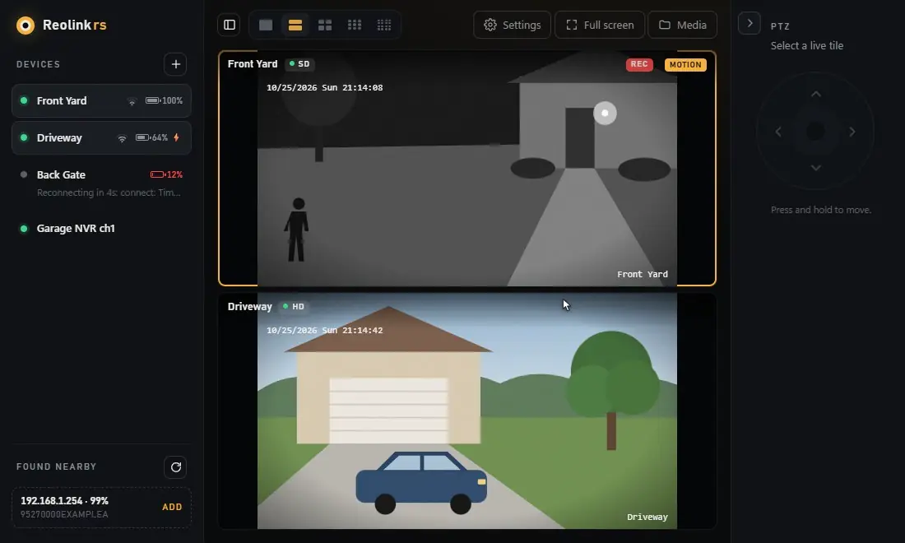
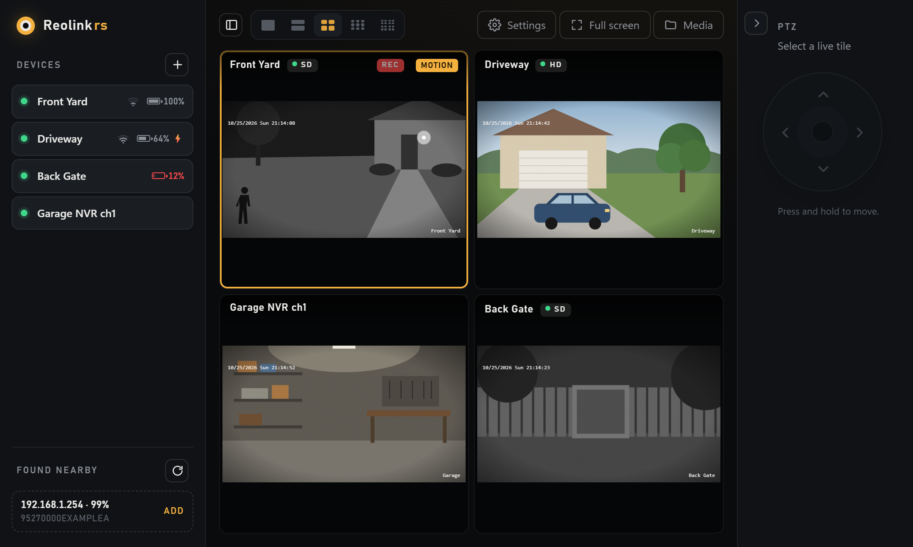
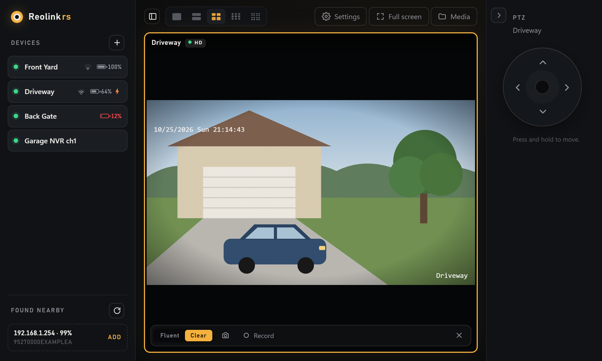
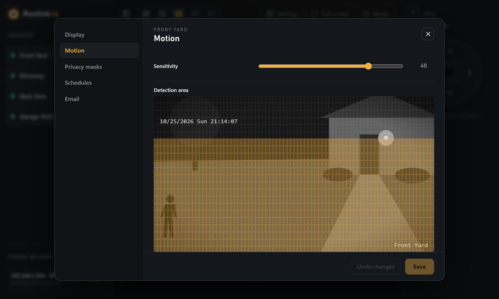
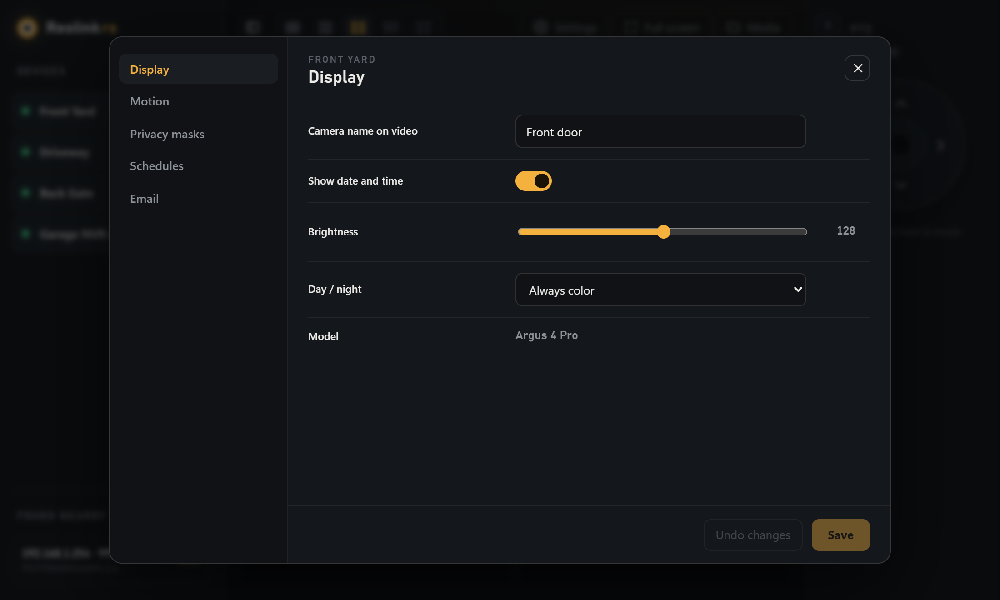

# Reolink-rs



Rust rewrite of the Reolink desktop client (reference: Reolink 8.21.31, Electron), built on
[`neolink_core`](https://github.com/QuantumEntangledAndy/neolink) for the Baichuan protocol and a Tauri 2 UI
(plain HTML/CSS/JS in `ui/`, no Node build). Video reaches the WebView from a token-protected 127.0.0.1 server
(`src/stream.rs`): the camera's own H.264/H.265, decoded in the page with WebCodecs, or MJPEG made by ffmpeg on
Linux and wherever the WebView can't decode the codec. Recordings are fragmented-MP4 stream copies of the main stream.

**Deliberate difference from the official client:** no battery/idle disconnect. Every device stays
connected (pinged every 5 s) and reconnects automatically, resuming its live view and recording.

`neolink_core/` is a vendored copy (upstream rev 6e05e78) with Windows fixes:
- UDP sockets disable `SIO_UDP_CONNRESET`; otherwise one ICMP "port unreachable" kills discovery with error 10054.
- Stream and connection task errors are surfaced/logged instead of a bare `StreamFinished`.
- Unparseable frames, stray extension payloads and bad UDP datagrams are skipped instead of dropping the connection.
- `get_xml`/`set_xml` raw settings access (read-modify-write keeps fields the typed model doesn't know).
- `is_aes()` reports whether login negotiated AES; the app refuses a camera that used AES before and later offers less.

| Live grid | Single view |
|---|---|
|  |  |
| **Motion zone over a live snapshot** | **Camera settings** |
|  |  |

Re-record the demo above (Playwright + ffmpeg, synthetic feeds): `node docs/demo/record.cjs`; retake the screenshots: `node docs/demo/screenshots.cjs`.

Test a saved camera end to end (stream, decode, ~8 s recording): `cargo run --example probe -- "<device name>" [main|sub]`.
Check that recording takes the main stream and a snapshot doesn't stall it: `cargo run --example record_stream_check -- "<device name>"`.
Serve one camera's stream for trying the WebCodecs player in a browser: `cargo run --example raw_check -- "<device name>" [main|sub] [secs]`.
Measure each saved camera's video/audio bitrate per stream: `cargo run --release --example bitrate`.
Validate camera settings (add `--write` for reversible write checks): `cargo run --release --example settings_check`.
Dump every readable settings message as XML (passwords redacted): `cargo run --release --example settings_dump -- <dir>`.

## Run

Requires `ffmpeg.exe` on PATH or next to the exe (used to write MP4s, and to decode where WebCodecs can't).

```bash
cargo run --release
```

Devices are saved to `%APPDATA%\Reolink-rs\devices.json` (`~/.config/Reolink-rs` on Linux, `~/Library/Application Support/Reolink-rs` on macOS). Camera passwords are not in that file: they live in the OS credential store (Windows Credential Manager, macOS Keychain, Secret Service on Linux) under "Reolink-rs", and move there automatically from older configs. Snapshots and recordings go to `Videos\Reolink-rs` in your user folder.

## Status

Phase 1 (done): add/edit/remove devices (IP or UID, NVR channel), 1 / 2-stacked / 4 / 9 / 16 live layouts,
Clear/Fluent streams, double-click a tile for single view (Esc to exit), collapsible PTZ panel (hold to move),
snapshot, MP4 recording, battery level.

Phase 2 (done): camera settings, 14 pages, 119 fields per camera: device info, display, stream, detection &
recording, motion (read-only on Argus 4 Pro), privacy masks, schedules, email, FTP, network, smart detection &
time-lapse, lights, system, maintenance, with schedule/area/mask editors drawn over a live snapshot, email/FTP
tests, time sync and reboot. App settings: folders, recording segments, disk-space warning, GPU decoding,
network scan, run at startup. LAN auto-detect of cameras. Inventory, SDK command table and validation results:
[docs/settings-inventory.md](docs/settings-inventory.md).

Playback (local files and camera SD recordings): Playback in the left sidebar opens an NVR view of the recording
folder: day picker, one timeline row per camera (click to play, scroll to zoom, drag to pan), segments play back
to back across gaps, 0.25-16x speed, frame step, ±10 s, clip export (In/Out, no re-encode, into `Clips\`),
still frame to the snapshot folder, show in folder, delete, and a Thumbnails view of the day's recordings
(preview frames cached in `.thumbs\`). A scrubber under the player shows the position in the open recording and
the In/Out range; the wheel zooms into the picture (up to 8x, drag to pan); the recordings list can show
thumbnails. Live streams pause while it's open.
Playback's **Recordings from** selector switches between **Local storage** and **Camera SD card**.
For Camera SD, choose a saved camera and a date; select a recording to download it into the app's playback cache and play it.
**Make default** saves the selected source for future visits and app restarts; App settings also has a **Default playback source** choice.
SD browsing uses the camera's clock. Downloads are limited to 1 GB and five minutes of transfer time per clip;
unsupported cameras and offline cameras show an error with a Refresh option. Cached SD clips remain separate from the local recording folder.
Delete, clip export and snapshots in this player apply to local recordings; camera SD contents are never deleted by this feature.
Hardware check: `cargo run --example sd_playback_check -- "<camera name>" YYYY-MM-DD --download --sample` (five-second sample).

Keys: Space, ← → (Shift: 1 min), Home / End, , . (frame), [ ] (speed), I / O, F, + - 0 (zoom). Double-click: full screen.
The day list and arrows step between days that have recordings; a time box jumps to a time (a gap plays the next
recording and says so). Clip In/Out can be typed as times; the export result stays on screen with Show in folder.

Arrange the live grid: drag a camera by its name onto another tile to swap them (or onto an empty one to move it),
and drag the borders between tiles to resize rows and columns. Each layout remembers its proportions; double-click
a border to make them equal again. Video keeps playing throughout.

Hold Ctrl and scroll over a live picture to zoom in and out around the pointer, up to 8×; drag to move around, and the chip
resets it. A tile's control bar also has the light (on for 3 minutes per click), the camera's speaker (talk through
it with this PC's microphone) and the siren (a second click confirms).

Smooth live view (0.4.13): cameras send each keyframe as fast as their uplink allows and the frames behind it
arrive in a burst, so the player shows every frame at its time on the camera's clock plus a small, self-measured
delay instead of as it arrives — no more freeze / fast-forward / freeze (`ui/playout.js`).

Motion recording (0.4.17): only video motion inside the painted detection area starts a motion recording; AI-only
alerts (person/vehicle from the camera's AI zones) no longer trigger it. Each alarm event is logged with the camera
name, status and AI type.

Live audio (0.4.19): a headphones button on each tile plays that camera's sound (one camera at a time, M toggles),
in step with the picture's delay; it goes quiet while you talk through that camera. Turn on Audio in the camera's
Clear/Fluent stream settings first.

Recordings with sound (0.4.20): manual, motion and scheduled recordings include the camera's AAC audio as a second
track in the MP4 (ADPCM cameras record video only).

PTZ presets (0.4.19): the PTZ panel lists the camera's presets; click one to go there, save the current position,
rename or delete. Cameras with a zoom lens also get zoom and focus buttons (hold to move).

Events and notifications (0.4.19): every motion start is logged (with person/vehicle when the camera says so) for 30
days in `events.jsonl` next to `devices.json`. Playback has an Events tab (click an event to play that moment) and red
motion markers on each timeline row; camera SD recordings show their people/vehicle/other markers too. App settings
has "Notify on motion": a desktop notification per camera at most once a minute, not while you're watching that camera
live; clicking it (Windows) shows the window on that camera.

SD playback streams (0.4.19): a camera SD clip starts playing while it downloads.

Camera settings (0.4.19): a Users page (list, add, change password, delete; the account the app logs in with and
administrators are protected; battery cameras refuse it) and AI detection's object types (people, vehicles, animals).

Live view health: a tile whose camera stops sending frames says "No new video for N s" with a Reconnect button
(the app also reconnects by itself after 20 s); an offline tile shows why, with Retry now. Recording paused (tray)
shows in both views, and clicking it resumes. Keyboard: Tab to a tile, arrows move between tiles, Shift+arrows move its camera, Enter for single
view, Esc back; hold Enter/Space on a PTZ arrow to move; schedule grids take arrows, Space, and Shift+arrows to paint.

Tray (0.4.1): minimizing or closing hides the window to the tray (left-click to show it again). The tray's
right-click menu has Show, Pause recording (stops manual and scheduled recording until unchecked) and Quit.

Reboot a saved camera and time its reconnect: `cargo run --example reboot_check -- "<device name>"`.

Current version: **0.4.20**.

Next phases toward parity with the official client:
1. Optical auto-focus; AI detection sensitivity and AI zones (Argus 4 Pro refuses those messages)
2. NVR hardware testing (channel discovery in Add camera, per-channel playback bitmap, device-wide settings on an NVR)
3. Manual firmware update and Wi-Fi network switching (message ids known, payloads and order still need a capture of
   the official client: [docs/lens-preset-firmware-wifi-evidence.md](docs/lens-preset-firmware-wifi-evidence.md))
4. Editing user permissions (the protocol only offers user vs administrator at creation)

## Patching the official client instead

`patch/patch_battery_timeout.py` removes the same disconnect from the installed Electron app.
Run it from an elevated shell; re-run after every Reolink update.

## License

AGPL-3.0-or-later (inherited from `neolink_core`).
